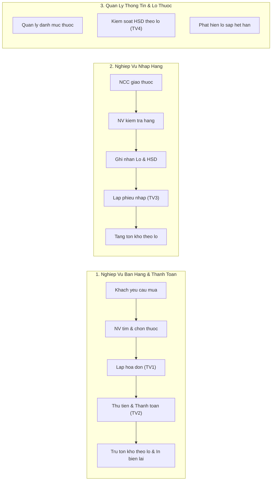
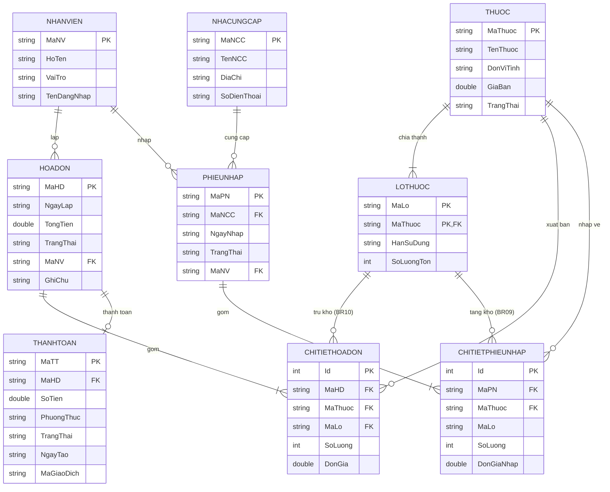
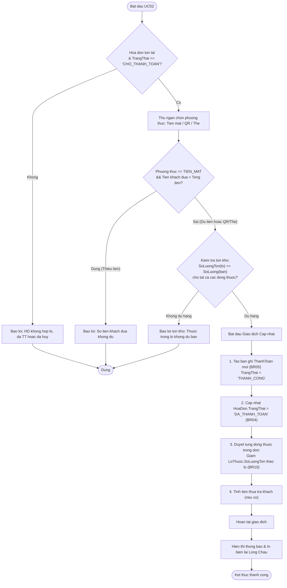
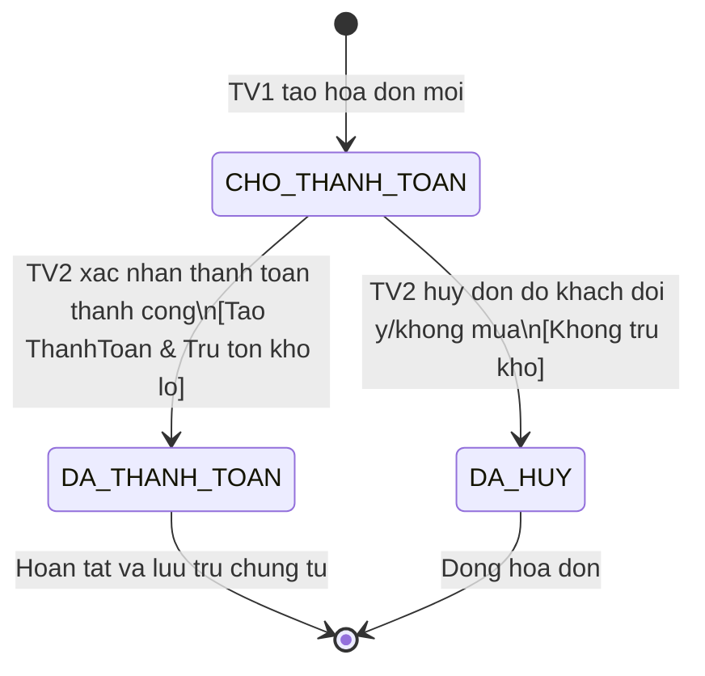

# HE THONG QUAN LY BAN HANG VA TON KHO NHA THUOC LONG CHAU
> **Hoc phan:** Phan tich & Thiet ke He thong Thong tin (Chuan mau do an PTIT)  
> **Quy mo:** Nhom 4 thanh vien - Ngon ngu trien khai: **Java (100% Thuan tuy - Zero Dependency)**  
> **Pham vi:** Mo phong phuc vu hoc tap tai mot chi nhanh nha thuoc Long Chau

---

## MUC LUC
1. [Tong Quan De Tai](#1-tong-quan-de-tai)
2. [Cac Tac Nhan He Thong (Actors)](#2-cac-tac-nhan-he-thong)
3. [Cac Quy Trinh Nghiep Vu Chinh](#3-cac-quy-trinh-nghiep-vu-chinh)
4. [Danh Sach Use Case & Phan Cong 4 Thanh Vien](#4-danh-sach-use-case--phan-cong-4-thanh-vien)
5. [Quy Tac Nghiep Vu Thong Nhat (BR01 - BR12)](#5-quy-tac-nghiep-vu-thong-nhat)
6. [Mo Hinh Du Lieu So Bo & Quan He Thuc The](#6-mo-hinh-du-lieu-so-bo--quan-he-thuc-the)
7. [Mo Hinh Thuat Toan & Luong Xu Ly Nghiep Vu](#7-mo-hinh-thuat-toan--luong-xu-ly-nghiep-vu)
8. [Kien Truc Ky Thuat & Cau Truc Ma Nguon Java](#8-kien-truc-ky-thuat--cau-truc-ma-nguon-java)
9. [Huong Dan Bien Dich & Chay Chuong Trinh](#9-huong-dan-bien-dich--chay-chuong-trinh)

---

## 1. Tong Quan De Tai

### 1.1. Boi canh
Nha thuoc can quan ly dong thoi hoat dong ban le thuoc cho khach hang va viec tiep nhan thuoc tu nha cung cap. Hai hoat dong nay co lien he truc tiep voi so luong ton kho cua tung loai thuoc tai nha thuoc.  
Neu viec ghi nhan hoa don ban hang, thanh toan va nhap hang khong duoc quan ly thong nhat, du lieu ton kho se bi sai lech. Dac biet trong nganh duoc pham, viec khong theo doi chat che thong tin **lo thuoc** va **han su dung** co the dan den viec xuat ban thuoc het han, gay rui ro nghiem trong den suc khoe nguoi tieu dung.  
Do do, nhom de xuat xay dung he thong ho tro quan ly ban hang, nhap hang va kiem soat thong tin ton kho theo lo.

*(Luu y: Day la mo hinh nghiep vu gia dinh phuc vu muc dich hoc tap de an mon hoc, khong khang dinh la quy trinh van hanh noi bo chinh thuc cua FPT Long Chau).*

### 1.2. Muc tieu he thong
- Quan ly danh muc thuoc va thong tin thuoc (don vi tinh, gia ban, trang thai kinh doanh).
- Ho tro nhan vien lap hoa don ban hang nhanh chong, chinh xac.
- Ghi nhan va quan ly thanh toan da phuong thuc (Tien mat, Chuyen khoan QR, The POS).
- Ho tro tiep nhan thuoc tu nha cung cap va lap phieu nhap hang.
- Kiem soat ton kho chat che theo tung **ma lo** va **han su dung**.
- Cung cap cac bao cao co ban ve doanh thu, nhap hang va canh bao han dung.

### 1.3. Pham vi he thong
- **Pham vi thuc hien:**
  - Ap dung tai mot chi nhanh nha thuoc mo phong.
  - Quan ly danh muc thuoc, ban hang, thanh toan, nhap hang.
  - Ton kho tu dong tang khi xac nhan nhap va tu dong giam khi hoan tat thanh toan.
  - Theo doi han su dung theo lo va canh bao lo sap het han.
  - Bao cao thong ke co ban trong ca.
- **Ngoai pham vi (Khong trien khai trong do an):**
  - Quan ly chuoi lien chi nhanh hoac dieu phoi van chuyen giua cac kho.
  - Ke toan tong hop, bang luong nhan su, tai chinh chuyen sau.
  - Don thuoc dien tu quoc gia hoac cong xac thuc bao hiem y te.
  - Mua hang dau thau quy mo lon, toi uu hoa chuoi cung ung nang cao.

---

## 2. Cac Tac Nhan He Thong

| Tac nhan | Phan loai | Vai tro va Quyen han |
| :--- | :--- | :--- |
| **Nhan vien ban hang** | Tac nhan trong | Dang nhap he thong, tim kiem thuoc, lap hoa don (UC01), thuc hien thu tien va hoan tat thanh toan (UC02), in bien lai cho khach. |
| **Nhan vien nhap hang**| Tac nhan trong | Dang nhap he thong, tiep nhan thuoc giao den, kiem tra tinh trang hang, lap phieu nhap hang kem thong tin lo va han su dung (UC03). |
| **Quan ly nha thuoc** | Tac nhan trong | Quan ly danh muc thuoc (UC05), xem bao cao doanh thu (UC07), xem bao cao nhap - xuat - ton va canh bao han su dung (UC08). |
| **Khach hang** | Tac nhan ngoai | Yeu cau mua thuoc, kiem tra don hang, thuc hien thanh toan (tien mat/QR/the) va nhan thuoc kem bien lai (Khong can tai khoan). |
| **Nha cung cap** | Tac nhan ngoai | Giao thuoc va cung cap chung tu giao hang kem thong tin lo san xuat va han su dung (Khong can tai khoan). |

---

## 3. Cac Quy Trinh Nghiep Vu Chinh



### 3.1. Nghiep vu Ban hang va Thanh toan
1. Khach hang yeu cau mua thuoc tai quay.
2. Nhan vien ban hang tim kiem thuoc trong danh muc.
3. Nhan vien chon thuoc, chon lo phu hop va nhap so luong ban.
4. He thong kiem tra so luong ton kha dung cua lo va tinh tong tien hoa don.
5. Nhan vien xac nhan lap hoa don (`CHO_THANH_TOAN` - Trach nhiem cua TV1).
6. Khach hang chon phuong thuc tra tien (Tien mat, Chuyen khoan VietQR, The POS).
7. He thong ghi nhan ket qua thanh toan, doi trang thai hoa don sang `DA_THANH_TOAN` (Trach nhiem cua TV2).
8. He thong tru truc tiep ton kho cua tung lo thuoc tuong ung (BR10).
9. Nhan vien in bien lai, giao thuoc va bien lai cho khach hang.

### 3.2. Nghiep vu Tiep nhan va Nhap hang
1. Nha cung cap giao thuoc den nha thuoc kem hoa don/phieu giao hang.
2. Nhan vien nhap hang kiem tra thuc te: so luong, bao bi, han su dung va dieu kien bao quan.
3. Nhan vien ghi nhan thong tin nha cung cap, ma thuoc, ma lo san xuat va han su dung.
4. He thong tao phieu nhap hang va nhan vien xac nhan hoan tat (Trach nhiem cua TV3).
5. He thong luu phieu nhap va cong so luong ton vao tung lo thuoc tuong ung (BR09).

### 3.3. Nghiep vu Quan ly thong tin thuoc va Lo thuoc
1. Quan ly hoac nhan vien cap nhat thong tin danh muc thuoc (ten, quy cach, don vi tinh, gia ban, trang thai kinh doanh).
2. Khi nhap hang, he thong lien ket thuoc voi cac lo hang khac nhau.
3. He thong tong hop ton kho tu cac lo con han su dung.
4. Nguoi dung tra cuu thong tin han su dung, he thong dua ra canh bao cac lo sap het han (Trach nhiem cua TV4).

---

## 4. Danh Sach Use Case & Phan Cong 4 Thanh Vien

De dam bao tinh chuyen sau va dap ung dung tieu chi danh gia do an mon hoc, nhom phan chia **4 Use Case chinh xuyen suot** cho 4 thanh vien. Moi thanh vien hoan thanh day du **5 hang muc bat buoc** trong mau bao cao PTIT:
1. **Dac ta Use Case chi tiet** (Muc tieu, Actor, Pre/Post-conditions, Main flow, Alternative & Exception flows).
2. **Bieu do lop phan tich & Bieu do lop thiet ke** (Hien thuc hoa cac lop Boundary, Control, Entity hoac 3-tier).
3. **Bieu do tuan tu phan tich** (Analysis Sequence Diagram).
4. **Bieu do tuan tu thiet ke** (Design Sequence Diagram - day du phuong thuc, kieu tra ve).
5. **Giao dien & Ma nguon tuong ung** (UI, Service, DAO, Entity, Unit Tests).

### Bang phan cong cong viec chi tiet

| Thanh vien | Use Case phu trach xuyen suot | Trach nhiem chinh trong do an | Cong viec bo sung |
| :---: | :--- | :--- | :--- |
| **TV1** | **UC01 - Lap hoa don ban hang** | Tiep nhan yeu cau mua thuoc, tim kiem danh muc, chon thuoc va lo thuoc, tinh tong tien, tao hoa don o trang thai `CHO_THANH_TOAN`. | **Nhom truong**, tong hop noi dung bao cao, chuan hoa bieu do tong the he thong. |
| **TV2** | **UC02 - Thanh toan hoa don** | Xu ly thanh toan da phuong thuc (Tien mat, QR, The POS), tinh tien thua, ghi nhan giao dich `ThanhToan` (BR05), hoan tat hoa don `DA_THANH_TOAN` (BR04), kich hoat tru ton kho theo lo (BR10), in bien lai ban le. | **Quan ly cac trang thai hoa don va thanh toan** (State Machine), xu ly ngoai le huy don (`DA_HUY`), kiem soat tinh toan ven giao dich. |
| **TV3** | **UC03 - Tiep nhan va lap phieu nhap hang** | Tiep nhan thuoc tu nha cung cap, kiem tra chat luong, ghi nhan ma lo va HSD, tao phieu nhap `PhieuNhap` va tang so luong ton kho `LoThuoc` (BR09). | **Dieu phoi mo hinh lop va CSDL**, thiet ke ERD tong the, chuan hoa cau truc du lieu chung cua ca nhom. |
| **TV4** | **UC04 - Theo doi lo thuoc va han su dung** | Quan ly danh muc thuoc (`Thuoc`), tra cuu chi tiet tung lo thuoc (`LoThuoc`), tinh toan ton kho kha dung, loc va canh bao cac lo thuoc sap het han su dung. | **Bao cao thong ke co ban** (bao cao doanh thu, nhap hang va ton kho), ho tro kiem thu tich hop. |

---

## 5. Quy Tac Nghiep Vu Thong Nhat

Tat ca cac thanh vien phai tuan thu nghiem ngat 12 quy tac nghiep vu sau de tranh xung dot du lieu:

| Ma | Ten quy tac nghiep vu | Y nghia va Rang buoc trien khai |
| :---: | :--- | :--- |
| **BR01** | Dinh danh thuoc duy nhat | Moi thuoc co mot ma thuoc (`MaThuoc`) duy nhat trong he thong. |
| **BR02** | Trang thai kinh doanh | Chi nhung thuoc co trang thai `DANG_KINH_DOAN` moi duoc phep dua vao hoa don ban hang. |
| **BR03** | Gioi han so luong ban | So luong ban khong duoc vuot qua so luong ton kha dung cua lo thuoc duoc chon. |
| **BR04** | Hoan tat hoa don | Hoa don chi duoc chuyen sang trang thai hoan tat (`DA_THANH_TOAN`) khi thanh toan thanh cong. |
| **BR05** | Lien ket thanh toan | Moi giao dich thanh toan (`ThanhToan`) phai gan lien voi mot hoa don cu the (`MaHD`). |
| **BR06** | Dinh danh phieu nhap duy nhat| Moi phieu nhap co mot ma phieu nhap (`MaPN`) duy nhat trong toan he thong. |
| **BR07** | Da lo hang cho mot thuoc | Mot thuoc co the duoc nhap nhieu lan voi cac ma lo (`MaLo`) va han su dung khac nhau. |
| **BR08** | Thuoc tinh bat buoc cua lo | Moi lo thuoc bat buoc phai co ma lo (`MaLo`), han su dung (`HanSuDung`) va so luong nhap. |
| **BR09** | Tang ton kho khi nhap | So luong ton kho cua lo thuoc chi tang khi phieu nhap hang duoc xac nhan luu thanh cong. |
| **BR10** | Giam ton kho khi thanh toan | So luong ton kho cua lo thuoc giam tuong ung khi hoa don duoc thanh toan thanh cong. |
| **BR11** | Canh bao han su dung | He thong phai ho tro loc va canh bao cac lo thuoc co han su dung can ke (duoi 30-90 ngay). |
| **BR12** | Tinh khong am cua du lieu | Tuyet doi khong cho phep nhap so luong am, don gia am hoac so tien thanh toan am. |

---

## 6. Mo Hinh Du Lieu So Bo & Quan He Thuc The

### 6.1. Danh sach thuc the du lieu



* **Diem cot loi trong thiet ke:** Bang `ChiTietHoaDon` luu ca `MaThuoc` va `MaLo`. Nho do, khi xu ly thanh toan (TV2), he thong co the xac dinh chinh xac lo thuoc nao duoc xuat ban de tru ton kho theo lo (BR10), phuc vu cho viec kiem soat han dung cua TV4.

---

## 7. Mo Hinh Thuat Toan & Luong Xu Ly Nghiep Vu

### 7.1. Thuat toan xu ly UC02 - Thanh toan hoa don & Tru kho (Trong tam TV2)



### 7.2. Bieu do may trang thai (State Machine Diagram) do TV2 quan ly



---

## 8. Kien Truc Ky Thuat & Cau Truc Ma Nguon Java

Phan mem duoc hien thuc hoa **100% bang Java** theo mo hinh chuan **3-Layer Architecture (Presentation - Business Logic - Data Access)**, khong phu thuoc vao bat ky thu vien ben ngoai nao, san sang chay tren moi phien ban Java (JDK 8 den JDK 25+).

```
c:\Users\kn200\HTTT\
|-- run.bat                          # File 1-click bien dich va chay giao dien Java Swing
|-- test.bat                         # File 1-click chay kiem thu tu dong 6 bai test BR04, BR05, BR10
|-- README.md                        # Tai lieu dac ta tong the do an
|-- docs/
|   |-- BAO_CAO_TV2_UC02.md          # Bao cao chi tiet 5 phan cho TV2 chuan PTIT
|-- src/main/java/com/longchau/
    |-- model/                       # TANG THUC THE (Entity & Enums)
    |   |-- TrangThaiHoaDon.java     # Enum: CHO_THANH_TOAN, DA_THANH_TOAN, DA_HUY
    |   |-- TrangThaiThanhToan.java  # Enum: DANG_XU_LY, THANH_CONG, THAT_BAI
    |   |-- PhuongThucThanhToan.java # Enum: TIEN_MAT, CHUYEN_KHOAN, THE
    |   |-- NhanVien.java            # Thong tin nhan vien, vai tro thu ngan
    |   |-- Thuoc.java               # Thong tin thuoc, quy cach, don gia ban
    |   |-- LoThuoc.java             # Ma lo, HSD va so luong ton kho theo lo
    |   |-- ChiTietHoaDon.java       # Chi tiet don hang gan voi Thuoc & Ma lo
    |   |-- ThanhToan.java           # Ban ghi giao dich thanh toan (BR05)
    |   |-- HoaDon.java              # Doi tuong Hoa don ban hang
    |-- dao/                         # TANG TRUY XUAT DU LIEU (Data Access Object)
    |   |-- Database.java            # Mock DB mo phong CSDL quan he voi Seed Data Long Chau
    |   |-- HoaDonDAO.java           # Tim kiem, loc va cap nhat trang thai hoa don
    |   |-- ThanhToanDAO.java        # Luu ban ghi giao dich thanh toan
    |   |-- LoThuocDAO.java          # Kiem tra va tru ton kho theo lo (BR10)
    |-- service/                     # TANG NGHIEP VU (Business Logic Layer - TV2)
    |   |-- PaymentException.java    # Bat va dong goi cac ngoai le thanh toan
    |   |-- PaymentRequest.java      # DTO truyen thong tin tu View xuong Service
    |   |-- PaymentResult.java       # DTO tra ve ket qua thanh toan & tien thua
    |   |-- PaymentService.java      # Cot loi xu ly thanh toan, tru kho, huy don
    |-- view/                        # TANG GIAO DIEN NGUOI DUNG (Java Swing)
    |   |-- PaymentManagementFrame.java # Man hinh thu ngan chuyen nghiep Long Chau
    |   |-- ReceiptDialog.java       # Hop thoai in bien lai ban le cho khach
    |-- Main.java                    # Diem vao chuong trinh (Main Entry)
    |-- TestPaymentRunner.java       # Kiem thu tu dong 6 ca kiem thu nghiep vu
```

---

## 9. Huong Dan Bien Dich & Chay Chuong Trinh

### 9.1. Khoi chay giao dien nhanh (Khuyen dung)
- **Chay giao dien phan mem:** Nhap dup chuot vao file `run.bat` (hoac mo PowerShell go `.\run.bat`).
- **Chay kiem thu tu dong:** Nhap dup chuot vao file `test.bat` (hoac mo PowerShell go `.\test.bat`).

### 9.2. Bien dich va thuc thi thu cong bang Terminal
```powershell
# 1. Bien dich toan bo ma nguon Java vao thu muc bin:
& "$env:USERPROFILE\.jdks\openjdk-25.0.1\bin\javac.exe" -encoding UTF-8 -d bin (Get-ChildItem -Recurse -Filter *.java src).FullName

# 2. Khoi chay giao dien do hoa Java Swing:
& "$env:USERPROFILE\.jdks\openjdk-25.0.1\bin\java.exe" "-Dfile.encoding=UTF-8" -cp bin com.longchau.Main

# 3. Khoi chay bo kiem thu tu dong dong lenh:
& "$env:USERPROFILE\.jdks\openjdk-25.0.1\bin\java.exe" "-Dfile.encoding=UTF-8" -cp bin com.longchau.TestPaymentRunner
```

### 9.3. Ket qua kiem thu tu dong dat 100% (6/6 Test Cases)
```
===============================================================
 KIEM THU TU DONG CAC QUY TAC NGHIEP VU CUA THANH VIEN 2 (JAVA)
===============================================================
[PASS] Test 1: Lay thong tin hoa don cho thanh toan HD261115-001 thanh cong.
[PASS] Test 2: Thanh toan thanh cong! BR04 (Da thanh toan), BR05 (Gan ma TT), BR10 (Tru kho tu 150 xuong 149) deu chuan xac!
[PASS] Test 3: Bat chinh xac ngoai le khi tien khach dua khong du.
[PASS] Test 4: Bat chinh xac ngoai le khi co thanh toan hoa don da hoan tat.
[PASS] Test 5: Huy hoa don cho thanh toan thanh cong (Trang thai chuyen sang DA_HUY).
[PASS] Test 6: Bat chinh xac loi khong the huy hoa don da thanh toan hoan tat.
===============================================================
 KET QUA KIEM THU: 6 PASSED / 6 TOTAL
===============================================================
```
