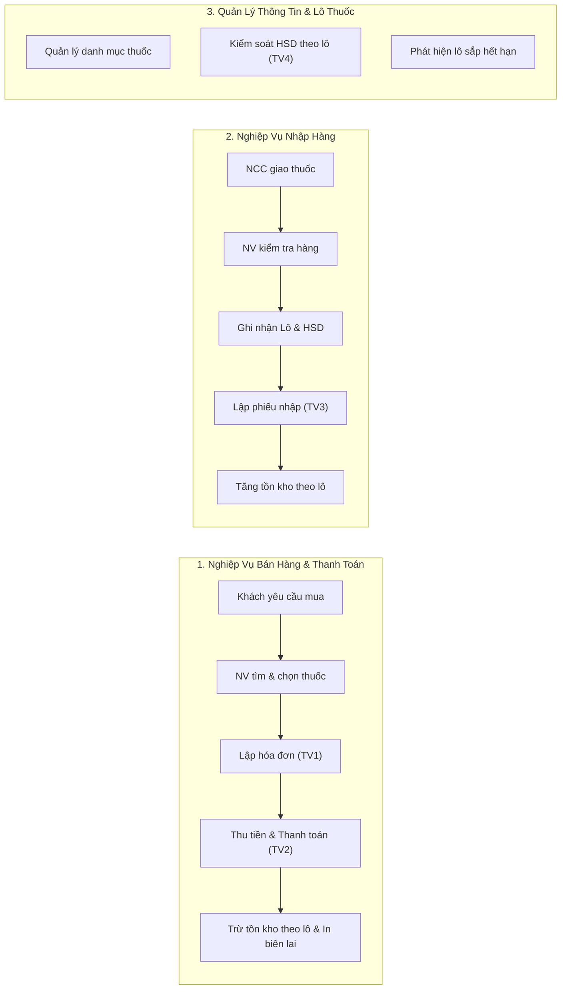
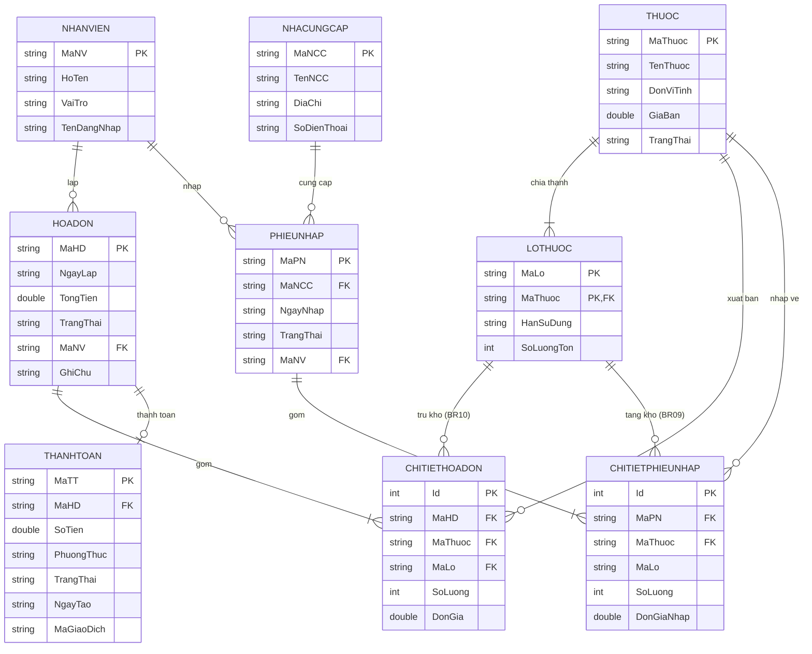
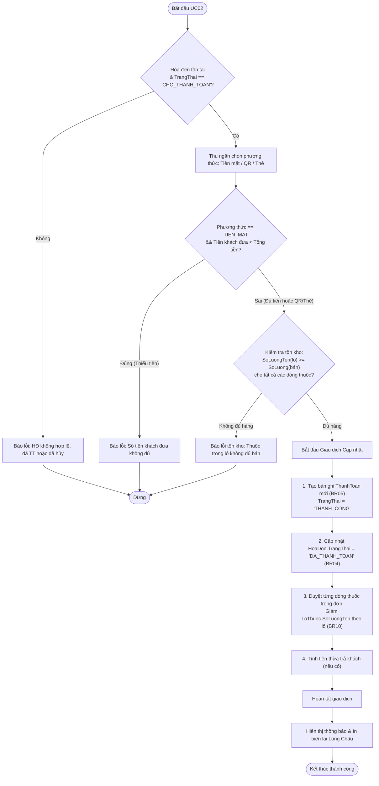
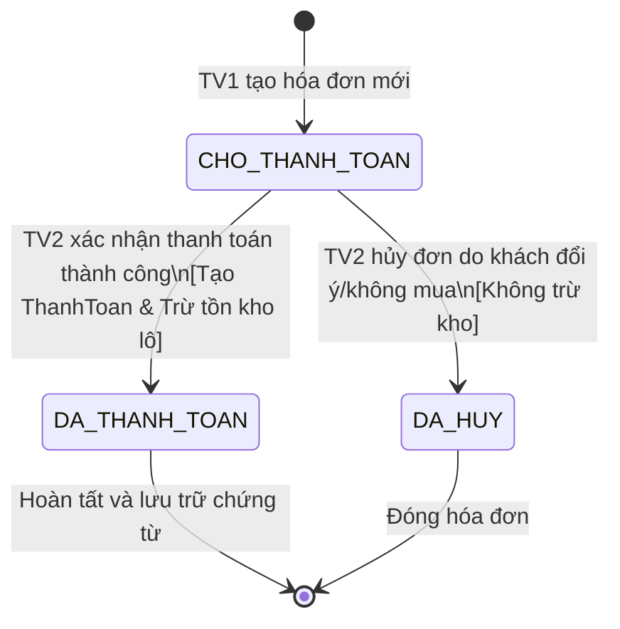

# HỆ THỐNG QUẢN LÝ BÁN HÀNG VÀ TỒN KHO NHÀ THUỐC LONG CHÂU
> **Học phần:** Phân tích & Thiết kế Hệ thống Thông tin (Chuẩn mẫu đồ án PTIT)  
> **Quy mô:** Nhóm 4 thành viên • Ngôn ngữ triển khai: **Java (100% Thuần túy - Zero Dependency)**  
> **Phạm vi:** Mô phỏng phục vụ học tập tại một chi nhánh nhà thuốc Long Châu

---

## MỤC LỤC
1. [Tổng Quan Đề Tài](#1-tổng-quan-đề-tài)
2. [Các Tác Nhân Hệ Thống (Actors)](#2-các-tác-nhân-hệ-thống)
3. [Các Quy Trình Nghiệp Vụ Chính](#3-các-quy-trình-nghiệp-vụ-chính)
4. [Danh Sách Use Case & Phân Công 4 Thành Viên](#4-danh-sách-use-case--phân-công-4-thành-viên)
5. [Quy Tắc Nghiệp Vụ Thống Nhất (BR01 – BR12)](#5-quy-tắc-nghiệp-vụ-thống-nhất)
6. [Mô Hình Dữ Liệu Sơ Bộ & Quan Hệ Thực Thể](#6-mô-hình-dữ-liệu-sơ-bộ--quan-hệ-thực-thể)
7. [Mô Hình Thuật Toán & Luồng Xử Lý Nghiệp Vụ](#7-mô-hình-thuật-toán--luồng-xử-lý-nghiệp-vụ)
8. [Kiến Trúc Kỹ Thuật & Cấu Trúc Mã Nguồn Java](#8-kiến-trúc-kỹ-thuật--cấu-trúc-mã-nguồn-java)
9. [Hướng Dẫn Biên Dịch & Chạy Chương Trình](#9-hướng-dẫn-biên-dịch--chạy-chương-trình)

---

## 1. Tổng Quan Đề Tài

### 1.1. Bối cảnh
Nhà thuốc cần quản lý đồng thời hoạt động bán lẻ thuốc cho khách hàng và việc tiếp nhận thuốc từ nhà cung cấp. Hai hoạt động này có liên hệ trực tiếp với số lượng tồn kho của từng loại thuốc tại nhà thuốc.  
Nếu việc ghi nhận hóa đơn bán hàng, thanh toán và nhập hàng không được quản lý thống nhất, dữ liệu tồn kho sẽ bị sai lệch. Đặc biệt trong ngành dược phẩm, việc không theo dõi chặt chẽ thông tin **lô thuốc** và **hạn sử dụng** có thể dẫn đến việc xuất bán thuốc hết hạn, gây rủi ro nghiêm trọng đến sức khỏe người tiêu dùng.  
Do đó, nhóm đề xuất xây dựng hệ thống hỗ trợ quản lý bán hàng, nhập hàng và kiểm soát thông tin tồn kho theo lô.

*(Lưu ý: Đây là mô hình nghiệp vụ giả định phục vụ mục đích học tập đề án môn học, không khẳng định là quy trình vận hành nội bộ chính thức của FPT Long Châu).*

### 1.2. Mục tiêu hệ thống
- Quản lý danh mục thuốc và thông tin thuốc (đơn vị tính, giá bán, trạng thái kinh doanh).
- Hỗ trợ nhân viên lập hóa đơn bán hàng nhanh chóng, chính xác.
- Ghi nhận và quản lý thanh toán đa phương thức (Tiền mặt, Chuyển khoản QR, Thẻ POS).
- Hỗ trợ tiếp nhận thuốc từ nhà cung cấp và lập phiếu nhập hàng.
- Kiểm soát tồn kho chặt chẽ theo từng **mã lô** và **hạn sử dụng**.
- Cung cấp các báo cáo cơ bản về doanh thu, nhập hàng và cảnh báo hạn dùng.

### 1.3. Phạm vi hệ thống
* **Phạm vi thực hiện:**
  - Áp dụng tại một chi nhánh nhà thuốc mô phỏng.
  - Quản lý danh mục thuốc, bán hàng, thanh toán, nhập hàng.
  - Tồn kho tự động tăng khi xác nhận nhập và tự động giảm khi hoàn tất thanh toán.
  - Theo dõi hạn sử dụng theo lô và cảnh báo lô sắp hết hạn.
  - Báo cáo thống kê cơ bản trong ca.
* **Ngoài phạm vi (Không triển khai trong đồ án):**
  - Quản lý chuỗi liên chi nhánh hoặc điều phối vận chuyển giữa các kho.
  - Kế toán tổng hợp, bảng lương nhân sự, tài chính chuyên sâu.
  - Đơn thuốc điện tử quốc gia hoặc cổng xác thực bảo hiểm y tế.
  - Mua hàng đấu thầu quy mô lớn, tối ưu hóa chuỗi cung ứng nâng cao.

---

## 2. Các Tác Nhân Hệ Thống

| Tác nhân | Phân loại | Vai trò và Quyền hạn |
| :--- | :--- | :--- |
| **Nhân viên bán hàng** | Tác nhân trong | Đăng nhập hệ thống, tìm kiếm thuốc, lập hóa đơn (UC01), thực hiện thu tiền và hoàn tất thanh toán (UC02), in biên lai cho khách. |
| **Nhân viên nhập hàng**| Tác nhân trong | Đăng nhập hệ thống, tiếp nhận thuốc giao đến, kiểm tra tình trạng hàng, lập phiếu nhập hàng kèm thông tin lô và hạn sử dụng (UC03). |
| **Quản lý nhà thuốc** | Tác nhân trong | Quản lý danh mục thuốc (UC05), xem báo cáo doanh thu (UC07), xem báo cáo nhập - xuất - tồn và cảnh báo hạn sử dụng (UC08). |
| **Khách hàng** | Tác nhân ngoài | Yêu cầu mua thuốc, kiểm tra đơn hàng, thực hiện thanh toán (tiền mặt/QR/thẻ) và nhận thuốc kèm biên lai (Không cần tài khoản). |
| **Nhà cung cấp** | Tác nhân ngoài | Giao thuốc và cung cấp chứng từ giao hàng kèm thông tin lô sản xuất và hạn sử dụng (Không cần tài khoản). |

---

## 3. Các Quy Trình Nghiệp Vụ Chính



### 3.1. Nghiệp vụ Bán hàng và Thanh toán
1. Khách hàng yêu cầu mua thuốc tại quầy.
2. Nhân viên bán hàng tìm kiếm thuốc trong danh mục.
3. Nhân viên chọn thuốc, chọn lô phù hợp và nhập số lượng bán.
4. Hệ thống kiểm tra số lượng tồn khả dụng của lô và tính tổng tiền hóa đơn.
5. Nhân viên xác nhận lập hóa đơn (`CHO_THANH_TOAN` - Trách nhiệm của TV1).
6. Khách hàng chọn phương thức trả tiền (Tiền mặt, Chuyển khoản VietQR, Thẻ POS).
7. Hệ thống ghi nhận kết quả thanh toán, đổi trạng thái hóa đơn sang `DA_THANH_TOAN` (Trách nhiệm của TV2).
8. Hệ thống trừ trực tiếp tồn kho của từng lô thuốc tương ứng (BR10).
9. Nhân viên in biên lai, giao thuốc và biên lai cho khách hàng.

### 3.2. Nghiệp vụ Tiếp nhận và Nhập hàng
1. Nhà cung cấp giao thuốc đến nhà thuốc kèm hóa đơn/phiếu giao hàng.
2. Nhân viên nhập hàng kiểm tra thực tế: số lượng, bao bì, hạn sử dụng và điều kiện bảo quản.
3. Nhân viên ghi nhận thông tin nhà cung cấp, mã thuốc, mã lô sản xuất và hạn sử dụng.
4. Hệ thống tạo phiếu nhập hàng và nhân viên xác nhận hoàn tất (Trách nhiệm của TV3).
5. Hệ thống lưu phiếu nhập và cộng số lượng tồn vào từng lô thuốc tương ứng (BR09).

### 3.3. Nghiệp vụ Quản lý thông tin thuốc và Lô thuốc
1. Quản lý hoặc nhân viên cập nhật thông tin danh mục thuốc (tên, quy cách, đơn vị tính, giá bán, trạng thái kinh doanh).
2. Khi nhập hàng, hệ thống liên kết thuốc với các lô hàng khác nhau.
3. Hệ thống tổng hợp tồn kho từ các lô còn hạn sử dụng.
4. Người dùng tra cứu thông tin hạn sử dụng, hệ thống đưa ra cảnh báo các lô sắp hết hạn (Trách nhiệm của TV4).

---

## 4. Danh Sách Use Case & Phân Công 4 Thành Viên

Để đảm bảo tính chuyên sâu và đáp ứng đúng tiêu chí đánh giá đồ án môn học, nhóm phân chia **4 Use Case chính xuyên suốt** cho 4 thành viên. Mỗi thành viên hoàn thành đầy đủ **5 hạng mục bắt buộc** trong mẫu báo cáo PTIT:
1. **Đặc tả Use Case chi tiết** (Mục tiêu, Actor, Pre/Post-conditions, Main flow, Alternative & Exception flows).
2. **Biểu đồ lớp phân tích & Biểu đồ lớp thiết kế** (Hiện thực hóa các lớp Boundary, Control, Entity hoặc 3-tier).
3. **Biểu đồ tuần tự phân tích** (Analysis Sequence Diagram).
4. **Biểu đồ tuần tự thiết kế** (Design Sequence Diagram - đầy đủ phương thức, kiểu trả về).
5. **Giao diện & Mã nguồn tương ứng** (UI, Service, DAO, Entity, Unit Tests).

### Bảng phân công công việc chi tiết

| Thành viên | Use Case phụ trách xuyên suốt | Trách nhiệm chính trong đồ án | Công việc bổ sung |
| :---: | :--- | :--- | :--- |
| **TV1** | **UC01 – Lập hóa đơn bán hàng** | Tiếp nhận yêu cầu mua thuốc, tìm kiếm danh mục, chọn thuốc và lô thuốc, tính tổng tiền, tạo hóa đơn ở trạng thái `CHO_THANH_TOAN`. | **Nhóm trưởng**, tổng hợp nội dung báo cáo, chuẩn hóa biểu đồ tổng thể hệ thống. |
| **TV2** | **UC02 – Thanh toán hóa đơn** | Xử lý thanh toán đa phương thức (Tiền mặt, QR, Thẻ POS), tính tiền thừa, ghi nhận giao dịch `ThanhToan` (BR05), hoàn tất hóa đơn `DA_THANH_TOAN` (BR04), kích hoạt trừ tồn kho theo lô (BR10), in biên lai bán lẻ. | **Quản lý các trạng thái hóa đơn và thanh toán** (State Machine), xử lý ngoại lệ hủy đơn (`DA_HUY`), kiểm soát tính toàn vẹn giao dịch. |
| **TV3** | **UC03 – Tiếp nhận và lập phiếu nhập hàng** | Tiếp nhận thuốc từ nhà cung cấp, kiểm tra chất lượng, ghi nhận mã lô và HSD, tạo phiếu nhập `PhieuNhap` và tăng số lượng tồn kho `LoThuoc` (BR09). | **Điều phối mô hình lớp và CSDL**, thiết kế ERD tổng thể, chuẩn hóa cấu trúc dữ liệu chung của cả nhóm. |
| **TV4** | **UC04 – Theo dõi lô thuốc và hạn sử dụng** | Quản lý danh mục thuốc (`Thuoc`), tra cứu chi tiết từng lô thuốc (`LoThuoc`), tính toán tồn kho khả dụng, lọc và cảnh báo các lô thuốc sắp hết hạn sử dụng. | **Báo cáo thống kê cơ bản** (báo cáo doanh thu, nhập hàng và tồn kho), hỗ trợ kiểm thử tích hợp. |

---

## 5. Quy Tắc Nghiệp Vụ Thống Nhất

Tất cả các thành viên phải tuân thủ nghiêm ngặt 12 quy tắc nghiệp vụ sau để tránh xung đột dữ liệu:

| Mã | Tên quy tắc nghiệp vụ | Ý nghĩa và Ràng buộc triển khai |
| :---: | :--- | :--- |
| **BR01** | Định danh thuốc duy nhất | Mỗi thuốc có một mã thuốc (`MaThuoc`) duy nhất trong hệ thống. |
| **BR02** | Trạng thái kinh doanh | Chỉ những thuốc có trạng thái `DANG_KINH_DOAN` mới được phép đưa vào hóa đơn bán hàng. |
| **BR03** | Giới hạn số lượng bán | Số lượng bán không được vượt quá số lượng tồn khả dụng của lô thuốc được chọn. |
| **BR04** | Hoàn tất hóa đơn | Hóa đơn chỉ được chuyển sang trạng thái hoàn tất (`DA_THANH_TOAN`) khi thanh toán thành công. |
| **BR05** | Liên kết thanh toán | Mỗi giao dịch thanh toán (`ThanhToan`) phải gắn liền với một hóa đơn cụ thể (`MaHD`). |
| **BR06** | Định danh phiếu nhập duy nhất| Mỗi phiếu nhập có một mã phiếu nhập (`MaPN`) duy nhất trong toàn hệ thống. |
| **BR07** | Đa lô hàng cho một thuốc | Một thuốc có thể được nhập nhiều lần với các mã lô (`MaLo`) và hạn sử dụng khác nhau. |
| **BR08** | Thuộc tính bắt buộc của lô | Mỗi lô thuốc bắt buộc phải có mã lô (`MaLo`), hạn sử dụng (`HanSuDung`) và số lượng nhập. |
| **BR09** | Tăng tồn kho khi nhập | Số lượng tồn kho của lô thuốc chỉ tăng khi phiếu nhập hàng được xác nhận lưu thành công. |
| **BR10** | Giảm tồn kho khi thanh toán | Số lượng tồn kho của lô thuốc giảm tương ứng khi hóa đơn được thanh toán thành công. |
| **BR11** | Cảnh báo hạn sử dụng | Hệ thống phải hỗ trợ lọc và cảnh báo các lô thuốc có hạn sử dụng cận kề (dưới 30-90 ngày). |
| **BR12** | Tính không âm của dữ liệu | Tuyệt đối không cho phép nhập số lượng âm, đơn giá âm hoặc số tiền thanh toán âm. |

---

## 6. Mô Hình Dữ Liệu Sơ Bộ & Quan Hệ Thực Thể

### 6.1. Danh sách thực thể dữ liệu



* **Điểm cốt lõi trong thiết kế:** Bảng `ChiTietHoaDon` lưu cả `MaThuoc` và `MaLo`. Nhờ đó, khi xử lý thanh toán (TV2), hệ thống có thể xác định chính xác lô thuốc nào được xuất bán để trừ tồn kho theo lô (BR10), phục vụ cho việc kiểm soát hạn dùng của TV4.

---

## 7. Mô Hình Thuật Toán & Luồng Xử Lý Nghiệp Vụ

### 7.1. Thuật toán xử lý UC02 – Thanh toán hóa đơn & Trừ kho (Trọng tâm TV2)



### 7.2. Biểu đồ máy trạng thái (State Machine Diagram) do TV2 quản lý



---

## 8. Kiến Trúc Kỹ Thuật & Cấu Trúc Mã Nguồn Java

Phần mềm được hiện thực hóa **100% bằng Java** theo mô hình chuẩn **3-Layer Architecture (Presentation - Business Logic - Data Access)**, không phụ thuộc vào bất kỳ thư viện bên ngoài nào, sẵn sàng chạy trên mọi phiên bản Java (JDK 8 đến JDK 25+).

```
c:\Users\kn200\HTTT\
├── run.bat                          # File 1-click biên dịch và chạy giao diện Java Swing
├── test.bat                         # File 1-click chạy kiểm thử tự động 6 bài test BR04, BR05, BR10
├── README.md                        # Tài liệu đặc tả tổng thể đồ án
├── docs/
│   └── BAO_CAO_TV2_UC02.md          # Báo cáo chi tiết 5 phần cho TV2 chuẩn PTIT
└── src/main/java/com/longchau/
    ├── model/                       # TẦNG THỰC THỂ (Entity & Enums)
    │   ├── TrangThaiHoaDon.java     # Enum: CHO_THANH_TOAN, DA_THANH_TOAN, DA_HUY
    │   ├── TrangThaiThanhToan.java  # Enum: DANG_XU_LY, THANH_CONG, THAT_BAI
    │   ├── PhuongThucThanhToan.java # Enum: TIEN_MAT, CHUYEN_KHOAN, THE
    │   ├── NhanVien.java            # Thông tin nhân viên, vai trò thu ngân
    │   ├── Thuoc.java               # Thông tin thuốc, quy cách, đơn giá bán
    │   ├── LoThuoc.java             # Mã lô, HSD và số lượng tồn kho theo lô
    │   ├── ChiTietHoaDon.java       # Chi tiết đơn hàng gắn với Thuốc & Mã lô
    │   ├── ThanhToan.java           # Bản ghi giao dịch thanh toán (BR05)
    │   └── HoaDon.java              # Đối tượng Hóa đơn bán hàng
    ├── dao/                         # TẦNG TRUY XUẤT DỮ LIỆU (Data Access Object)
    │   ├── Database.java            # Mock DB mô phỏng CSDL quan hệ với Seed Data Long Châu
    │   ├── HoaDonDAO.java           # Tìm kiếm, lọc và cập nhật trạng thái hóa đơn
    │   ├── ThanhToanDAO.java        # Lưu bản ghi giao dịch thanh toán
    │   └── LoThuocDAO.java          # Kiểm tra và trừ tồn kho theo lô (BR10)
    ├── service/                     # TẦNG NGHIỆP VỤ (Business Logic Layer - TV2)
    │   ├── PaymentException.java    # Bắt và đóng gói các ngoại lệ thanh toán
    │   ├── PaymentRequest.java      # DTO truyền thông tin từ View xuống Service
    │   ├── PaymentResult.java       # DTO trả về kết quả thanh toán & tiền thừa
    │   └── PaymentService.java      # Cốt lõi xử lý thanh toán, trừ kho, hủy đơn
    ├── view/                        # TẦNG GIAO DIỆN NGƯỜI DÙNG (Java Swing)
    │   ├── PaymentManagementFrame.java # Màn hình thu ngân chuyên nghiệp Long Châu
    │   └── ReceiptDialog.java       # Hộp thoại in biên lai bán lẻ cho khách
    ├── Main.java                    # Điểm vào chương trình (Main Entry)
    └── TestPaymentRunner.java       # Kiểm thử tự động 6 ca kiểm thử nghiệp vụ
```

---

## 9. Hướng Dẫn Biên Dịch & Chạy Chương Trình

### 9.1. Khởi chạy giao diện nhanh (Khuyên dùng)
* **Chạy giao diện phần mềm:** Nhấp đúp chuột vào file `run.bat` (hoặc mở PowerShell gõ `.\run.bat`).
* **Chạy kiểm thử tự động:** Nhấp đúp chuột vào file `test.bat` (hoặc mở PowerShell gõ `.\test.bat`).

### 9.2. Biên dịch và thực thi thủ công bằng Terminal
```powershell
# 1. Biên dịch toàn bộ mã nguồn Java vào thư mục bin:
& "$env:USERPROFILE\.jdks\openjdk-25.0.1\bin\javac.exe" -encoding UTF-8 -d bin (Get-ChildItem -Recurse -Filter *.java src).FullName

# 2. Khởi chạy giao diện đồ họa Java Swing:
& "$env:USERPROFILE\.jdks\openjdk-25.0.1\bin\java.exe" "-Dfile.encoding=UTF-8" -cp bin com.longchau.Main

# 3. Khởi chạy bộ kiểm thử tự động dòng lệnh:
& "$env:USERPROFILE\.jdks\openjdk-25.0.1\bin\java.exe" "-Dfile.encoding=UTF-8" -cp bin com.longchau.TestPaymentRunner
```

### 9.3. Kết quả kiểm thử tự động đạt 100% (6/6 Test Cases)
```
===============================================================
 KIỂM THỬ TỰ ĐỘNG CÁC QUY TẮC NGHIỆP VỤ CỦA THÀNH VIÊN 2 (JAVA)
===============================================================
[PASS] Test 1: Lấy thông tin hóa đơn chờ thanh toán HD261115-001 thành công.
[PASS] Test 2: Thanh toán thành công! BR04 (Đã thanh toán), BR05 (Gắn mã TT), BR10 (Trừ kho từ 150 xuống 149) đều chuẩn xác!
[PASS] Test 3: Bắt chính xác ngoại lệ khi tiền khách đưa không đủ.
[PASS] Test 4: Bắt chính xác ngoại lệ khi cố thanh toán hóa đơn đã hoàn tất.
[PASS] Test 5: Hủy hóa đơn chờ thanh toán thành công (Trạng thái chuyển sang DA_HUY).
[PASS] Test 6: Bắt chính xác lỗi không thể hủy hóa đơn đã thanh toán hoàn tất.
===============================================================
 KẾT QUẢ KIỂM THỬ: 6 PASSED / 6 TOTAL
===============================================================
```
